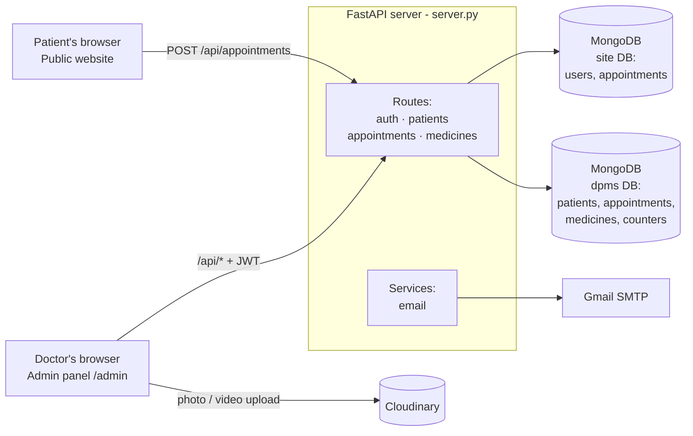

# Dr Chauhan Clinic: DermaCare Website & DPMS

A full-stack system for a dermatology (skin and hair) clinic, in two parts:

1. **Public website**: patients read about treatments and **book an appointment online**, and get a confirmation email.
2. **DPMS (Dermatology Patient Management System)**: an admin panel where doctors log in to handle website bookings, register patients and record each consultation (treatment, notes, medicines, blood tests, before/after photos and videos), and track medicine deliveries for online patients.

One FastAPI server runs everything: the REST API, the public website and the admin panel. No separate frontend server or build step is needed at runtime.

---

## Features

### Public website (`/`)
- Hero image slider, services, conditions treated, treatment process and FAQ
- A patient-reviews section that appears once real reviews are added to `assets/js/data.js` (hidden while the list is empty)
- **Online booking form** with online or clinic-visit consultation
- Instant on-screen confirmation; the confirmation **email** is sent in the background
- Booking is rate limited per IP address and per email address (HTTP `429` when exceeded)
- **Returning patients are recognised** (same phone + name) and their booking is linked to their existing record. The public request never edits the patient record; their online/clinic type is updated when a doctor starts the consultation
- SEO structured data (schema.org `MedicalClinic`), responsive layout and scroll animations

### Admin panel / DPMS (`/admin`)
- **Doctor login** with JWT; doctors create their own account on the Sign Up tab
- **Website Appointments**: see bookings from the website. One click on **Start** opens the registration form, pre-filled with the booking's details. Bookings can be marked **No Show** or **Cancelled**.
- **Offline patients** (clinic walk-ins) and **online patients** (remote consultation + medicine delivery) are managed separately
- **Patient registration**:
  - **Duplicate check** on the WhatsApp number
  - Sequential patient IDs (`PT-00001`)
  - The first consultation is saved as visit #1
- **Consultation records**:
  - Treatment (one shared list for registration and follow-up visits, plus custom names), doctor's notes and advice, with quick-pick chips for common conditions and advice
  - Blood test prescriptions in 7 categories
  - Medicines with an automatic bill total
  - Photo and video uploads
- **Before / after comparison**: photos or videos from any two visits side by side
- **Online orders**: payment details, plus courier dispatch date and tracking ID per visit (shown as Dispatched / Pending)
- **Medicine catalog**: add, edit and delete medicines with prices
- Search patients by name, WhatsApp number or patient ID; print or export a patient record as PDF
- After each consultation the patient gets a **thank-you email**

---

## Tech stack

| Layer | Technology | Why it's used |
|---|---|---|
| Backend framework | **FastAPI** (Python) | Async, validates requests automatically, auto-generated API docs at `/docs` |
| Server | **Uvicorn** | ASGI server that runs FastAPI |
| Database | **MongoDB** (Atlas or local) | A patient's visits, medicines and photos are nested data, which fits one document per patient |
| Database driver | **Motor** | Async MongoDB driver, so database calls don't block the server |
| Validation | **Pydantic v2** | Defines the shape of valid data and rejects bad input with a clear `422` error |
| Authentication | **bcrypt** + **PyJWT** | Salted password hashes; stateless login tokens that expire after 24 hours |
| Email | Python `smtplib` (e.g. Gmail SMTP) | Booking and post-visit emails, run in a worker thread so they don't block the server |
| Media storage | **Cloudinary** | Photos and videos upload straight from the browser; only the URL is stored |
| Frontend | **HTML, CSS, vanilla JavaScript** (ES modules) | No framework and no build step; the admin panel is a single-page app with a hand-written router |
| Styling | Plain **CSS** files | `site.css` (public site) and `admin.css` (admin panel), served as-is |

---

## Architecture



- Requests to `/api/*` go to the API, `/admin/*` returns the admin single-page app (deep links work on refresh), and every other path serves the public website.
- **Two databases:** the site database keeps the raw website bookings and user accounts. The `dpms` database is the clinic's working data, where bookings get a status and are linked to patients.

### Booking flow
1. The patient submits the form, and FastAPI validates it (name, phone, email format, age 0–120, consultation type, a real date).
2. The rate limit is checked: 5 bookings per IP address per hour and 5 per email address per day.
3. The booking is saved to the site DB and mirrored into `dpms.appointments` with status `New`.
4. If a patient with the same phone and name exists, the booking is linked to their `patient_id` (source `Existing Patient Booking`).
5. The API responds immediately. The confirmation email (if an address was given) is sent afterwards as a background task.

### Consultation flow
**Website Appointments** → **Start** (status becomes `Consultation Started`), then:
- **New patient:** the registration form is pre-filled from the booking → the patient is registered and the booking is linked to them (source `Registered from Website`).
- **Returning patient:** their record opens with a new consultation pre-filled (the booked treatment, date and consultation type). Their online/clinic type is updated to match the booking at this point. Saving the visit marks the booking `Completed`.

After a visit is saved the patient gets the thank-you email. The backend also stores a default `next_visit` 30 days ahead; it is not mentioned in the email because a doctor hasn't confirmed it.

---

## Data model

A patient document in `dpms.patients` (visits are embedded):

```json
{
  "patient_id": "PT-00001",
  "full_name": "Priya Sharma",
  "whatsapp": "9876543210",
  "email": "priya@example.com",
  "age": 29,
  "gender": "Female",
  "patient_type": "online",
  "medical_history": "PCOS, Thyroid Disorder",
  "next_visit": "2026-11-15T10:00:00+00:00",
  "visits": [
    {
      "visit_id": "uuid",
      "date_of_visit": "2026-10-15T10:00",
      "treatment": "PRP (Platelet Rich Plasma)",
      "doctor_notes": "Diffuse thinning at crown",
      "doctor_advice": "increase protein intake",
      "photos": ["https://res.cloudinary.com/..."],
      "medicines": [{ "name": "Biotin", "price": 250 }],
      "blood_tests": ["Vitamin D (25-OH)", "Serum Ferritin"],
      "amount_paid": 1500,
      "tracking_id": "TRK123",
      "next_visit": "2026-11-15T10:00:00+00:00"
    }
  ]
}
```

| Collection | Contents |
|---|---|
| `users` | Doctor/admin accounts (bcrypt password hash, role) |
| `appointments` (site DB) | Raw website bookings |
| `dpms.appointments` | Clinic copy of bookings with status, source and linked `patient_id` |
| `dpms.patients` | Patients with their embedded visits |
| `dpms.medicines` | Medicine catalog (name, price, description) |
| `dpms.counters` | Counter used to generate sequential patient IDs |
| `rate_limits` (site DB) | Booking rate-limit counters (hashed keys, deleted automatically by a TTL index) |

---

## API endpoints

All endpoints are under `/api`. 🔒 means the `Authorization: Bearer <token>` header is required. Interactive docs are at **http://localhost:8000/docs**.

| Method | Endpoint | Auth | Description |
|---|---|---|---|
| POST | `/auth/register` | – | Create a doctor account (open sign-up) |
| POST | `/auth/login` | – | Log in and receive a JWT |
| POST | `/appointments` | – | Book an appointment (public website; rate limited) |
| GET | `/appointments` | 🔒 | List clinic appointments (filter: `source`, `patient_id`) |
| PUT | `/appointments/{id}` | 🔒 | Update status / linked patient |
| POST | `/notify/post-visit` | 🔒 | Send the post-visit thank-you email |
| GET | `/patients` | 🔒 | Search patients (`patient_type`, `name`, `whatsapp`, `patient_id`) |
| POST | `/patients` | 🔒 | Register a patient with their first consultation |
| GET | `/patients/{patient_id}` | 🔒 | Get one patient with all visits |
| PUT | `/patients/{patient_id}` | 🔒 | Update details and/or add a new visit (`visit`) |
| PATCH | `/patients/{patient_id}/visit-dispatch` | 🔒 | Set dispatch date and tracking ID for a visit |
| DELETE | `/patients/{patient_id}` | 🔒 Admin | Delete a patient |
| GET / POST | `/medicines` | 🔒 | List / add medicines |
| PUT / DELETE | `/medicines/{id}` | 🔒 | Edit / delete a medicine |
| GET | `/health` | – | Health check |

---

## Security

- **Passwords:** stored only as **bcrypt** salted hashes, 6 characters to 72 bytes (bcrypt's limit). Login takes the same time for unknown usernames.
- **Login tokens:** **JWT** (HS256) that expires after 24 hours. One shared FastAPI dependency (`app/security.py`) checks it on every protected route. The server refuses to start without `JWT_SECRET`.
- **Roles:** new accounts are always `Doctor`; the role is never taken from the request. Deleting a patient is checked on the server and needs the `Admin` role.
- **Sign-up:** open. Anyone who can reach `/admin` can create a **Doctor** account, which can read all patient records. New accounts are never Admin, and usernames are unique.
- **Input validation:** Pydantic models validate every request body. Appointment updates can only change `status`, `patient_id` and `source`, and the status must be one of a fixed list. Medicine prices and stock can't be negative.
- **Rate limiting:** the public booking endpoint, with counters in MongoDB so the limit holds across several server processes. Behind a reverse proxy, uvicorn must trust it (`--forwarded-allow-ips`), or every visitor shares the proxy's IP.
- **Logs:** patient email addresses are masked (`p***@example.com`).
- **XSS protection:** user-entered data, such as names from the public booking form, is HTML-escaped before it's shown in the admin panel or in emails.
- **Injection:** every search term (name, WhatsApp, patient ID, booking name match) goes through `re.escape` before being used in a MongoDB regex.
- **Unique indexes** on `patient_id` and `username`.
- **Secrets** live in `backend/.env`, which is git-ignored.

---

## Project structure

```
backend/
  server.py                 FastAPI app: API routes, static file serving, startup indexes
  requirements.txt          Runtime dependencies (pinned)
  requirements-dev.txt      Test dependencies: pytest, httpx, mongomock-motor
  pytest.ini
  tests/                    API tests on an in-memory database, plus a uvicorn startup test
  app/
    config.py               Settings loaded from backend/.env
    database.py             MongoDB clients (site DB + dpms DB)
    models.py               Pydantic request/response models
    security.py             JWT login check and Admin-role dependency
    rate_limit.py           MongoDB-backed rate limiter (public booking)
    routes/
      auth.py               Register / login
      appointments.py       Public booking + clinic appointment management
      patients.py           Patient records, visits, dispatch
      medicines.py          Medicine catalog
    services/
      email.py              SMTP email sending (non-blocking)
      notifications.py      Booking and post-visit email templates
frontend/
  index.html                Public website
  assets/js/data.js         Website content rendered by site.js (services, reviews, booking options)
  assets/js/site.js         Slider, animations, booking form
  assets/css/site.css       Public site styles (utility-class CSS, originally generated with Tailwind)
  admin/
    index.html              Admin single-page app shell
    js/main.js              Route registration
    js/router.js            History-API router with login guard
    js/api.js               fetch wrapper (adds JWT, handles 401)
    js/auth.js              Token storage in sessionStorage
    js/escape.js            HTML escaping helper
    js/dialog.js            Modal dialog shell used by every admin dialog
    js/format.js            Date formatting and appointment-status chips
    js/constants.js         Appointment status and source values (same as the backend)
    js/clinicOptions.js     Shared treatment, advice and medical-history lists
    js/cloudinaryUpload.js  Direct browser-to-Cloudinary uploads
    js/views/               Login, dashboard, website appointments, patient page (patientDetail.js)
    js/views/patientDetail/ The patient page's tabs (history, consultation, appointments) and dialogs
    js/components/          Patient form and list, blood-test and medicine pickers, custom-treatment
                            dialog, medicines panel, sidebar
```

---

## Getting started

### Prerequisites
- Python 3.10+
- A MongoDB database (local, or a free MongoDB Atlas cluster)
- Optional: a Gmail app password (email), a Cloudinary account (uploads)

### 1. Configure environment variables

Create `backend/.env`:

```env
MONGO_URL=mongodb+srv://<user>:<password>@<cluster>/   # or mongodb://localhost:27017
DB_NAME=dermacare_db
JWT_SECRET=<long random string>

# Optional: email
SMTP_HOST=smtp.gmail.com
SMTP_PORT=587
SMTP_USER=you@gmail.com
SMTP_PASSWORD=<gmail app password>
SMTP_FROM_NAME=DermaCare

```

| Variable | Required | Purpose |
|---|---|---|
| `MONGO_URL`, `DB_NAME` | Yes | Database connection; `DB_NAME` is the site database |
| `DPMS_DB_NAME` | No | Clinic database name (default `dpms`) |
| `JWT_SECRET` | **Yes** | Signs login tokens; the server won't start without it |
| `SMTP_*` | No | Without it, emails are skipped and a warning is logged |

If you use MongoDB Atlas, add your IP address under **Network Access**. Otherwise the API returns `503` ("Can't reach the database right now") and the server log names the likely cause.

Cloudinary settings (cloud name and unsigned upload preset) are in `frontend/admin/js/cloudinaryUpload.js`.

### 2. Install and run

```bash
cd backend
pip install -r requirements.txt
python server.py
```

| URL | What |
|---|---|
| http://localhost:8000 | Public website |
| http://localhost:8000/admin | Admin panel (DPMS) |
| http://localhost:8000/docs | Interactive API docs |

`python server.py` runs with auto-reload for development. In production run uvicorn directly, without `--reload`, e.g. `uvicorn server:app --host 0.0.0.0 --port 8000`, adding `--forwarded-allow-ips=<proxy IP>` when it sits behind a reverse proxy.

### 3. Create the first account
Open `/admin` and create an account on the **Doctor Sign Up** tab. To make an account **Admin** (allowed to delete patients), set `role: "Admin"` on its document in the `users` collection.

### Styling

There is no CSS build step: edit `frontend/assets/css/site.css` (public site) or
`frontend/admin/assets/admin.css` (admin panel) directly. `site.css` was generated once with
Tailwind, so the HTML uses its utility class names (`flex`, `mt-4`, `text-slate-600`...). Only the
classes already in `site.css` exist; a new one needs a rule added to the file.

### Running the tests

The backend tests never touch a real database or mail server: they replace MongoDB with an
in-memory mock, record emails instead of sending them, and fail if anything tries to open an
outside network connection.

```bash
cd backend
pip install -r requirements-dev.txt
python -m pytest
```

The frontend has no automated tests; check it in a browser.

---

## Before launch

The public site still contains placeholders that must be replaced with verified details (each
is marked `PLACEHOLDER` in `frontend/index.html`):

- Phone number `9876543210` / `+91 9876543210`: navbar, About section, Contact, footer, floating
  call / WhatsApp buttons and the structured data
- Address "DermaCare Clinic, MG Road, Sample City – 000001, Sample State": Contact section and the
  structured data
- The doctor's photo in the About section (currently the clinic logo)
- Optionally, the clinic's own photos in place of the stock images in `assets/js/data.js`
- Patient reviews: add only real reviews shared with the patient's consent
- Sign-up is open: anyone who finds `/admin` can create a Doctor account and see patient records.
  Before real patient data is stored, restrict sign-up (for example, have an Admin create accounts).

`index.html` also has `<meta name="robots" content="noindex, nofollow">`; remove it when the site
should appear in search results.

---

## Roadmap

- Continuous integration running both test suites
- Pagination for large patient lists (lists currently return the latest 100 patients / 200 appointments)
- Password reset and an admin screen for managing user roles
- Appointment reminders (an earlier version was removed because it didn't work reliably)
- A doctor-confirmed next-visit date (today the backend stores an unconfirmed default 30 days ahead)
- Signed Cloudinary uploads and private delivery for patient photos
